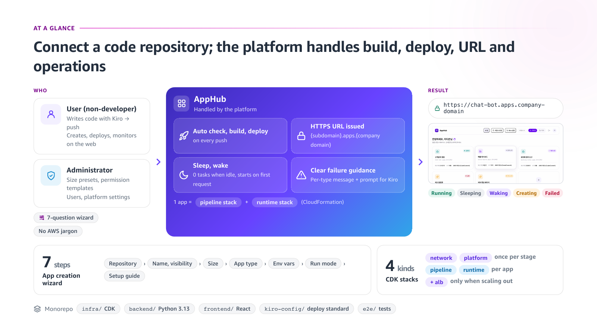
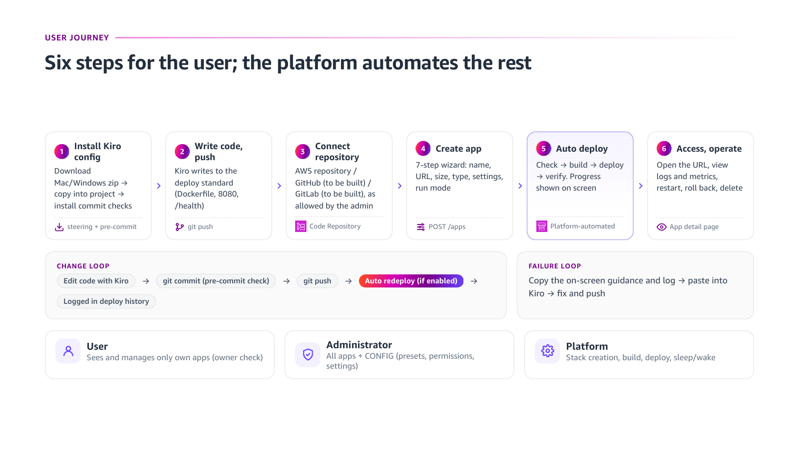
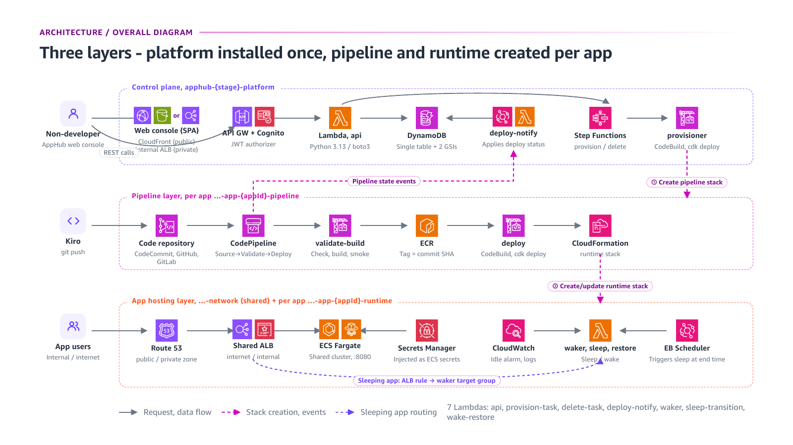
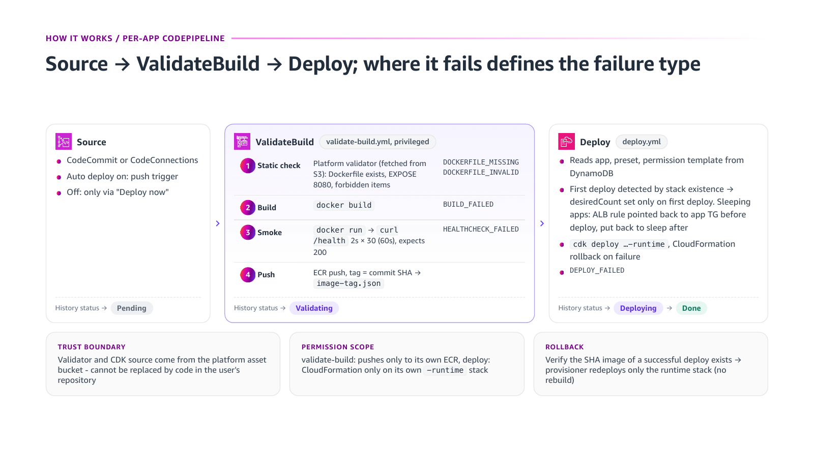

# AppHub: App Deployment Platform for Non-Developers

**English** | [한국어](README.ko.md)

An internal deployment platform that lets non-developers take application code written with Kiro
from a connected repository to a running, monitored service, **all from one web console**.

> **AppHub** is a working name; stacks and resources use the `apphub` prefix.

## Solution overview

Full presentation: [`presentation/AppHub-workload-overview-en.pdf`](presentation/AppHub-workload-overview-en.pdf) (Korean: [`AppHub-workload-overview-ko.pdf`](presentation/AppHub-workload-overview-ko.pdf))









## Design principles

1. **Minimal technical options**: users never see AWS terms. Choices are narrowed to presets defined by the administrator and non-technical questions.
2. **Everything as code**: both the platform and user apps are defined in CDK, and deployments are idempotent.
3. **No load on the main server**: all build and deploy work runs in CodeBuild (temporary remote environments). The platform API only accepts requests and reports status.
4. **Friendly failures**: build and deploy failures are classified by type and shown as guidance a non-developer can understand (in Korean).

## Architecture

Three layers:

- **Control plane**: React SPA + API Gateway/Lambda (Python 3.13, boto3) + DynamoDB + Step Functions + Cognito.
  The platform web is chosen at install time with `--frontend-mode`: **public** (CloudFront + S3, Regional API) or
  **private** (internal network only: a dedicated internal ALB + ECS nginx, Private API + VPC endpoints).
  In both modes the console is at `https://console.<appsDomain>` and sign-in uses the SPA's own screen (calling the Cognito API directly).
- **Pipeline layer**: a CodePipeline per app with two CodeBuild stages (validate and build, then deploy) and ECR. Runs remotely.
- **App hosting layer**: shared ALBs per visibility (host-based routing, automatically scaled out when close to the rule limit) + ECS Fargate (shared cluster)
  + Route 53 (`*.<appsDomain>`; internal apps use a private zone, internet-facing apps use public and private zones) + Secrets Manager.

One app = two CloudFormation stacks (`pipeline` + `runtime`). CloudFormation guarantees idempotency, and deleting an app
is just deleting its two stacks, so no resources are left behind.

### CDK stacks

| Stack | Contents | Deployed by |
|---|---|---|
| `apphub-{stage}-network` | 2 shared ALBs (n=0), shared ECS cluster, wildcard ACM certificate, private hosted zone, security groups, Waker/restore/sleep Lambdas + a Waker target group per ALB, shared SSM values | Administrator (`deploy.sh`) |
| `apphub-{stage}-platform` | Cognito, DynamoDB, API Gateway + Lambda, Step Functions, provisioner CodeBuild + platform web (per mode; public: CloudFront + us-east-1 certificate, private: console ALB + ECS nginx + VPC endpoints + Private API) | Administrator (`deploy.sh --frontend-mode`) |
| `apphub-{stage}-alb-{internet\|internal}-{n}` (n≥1) | One additional ALB + listener + dedicated Waker target group + SSM outputs. Created automatically when app creation detects the rule capacity is running low (owned by the platform, independent of app deletion) | Platform (provisioner) |
| `apphub-{stage}-app-{appId}-pipeline` | Per-app CodePipeline, 2 CodeBuild projects, ECR | Platform (provisioner) |
| `apphub-{stage}-app-{appId}-runtime` | ECS service/task, target group, listener rule on the assigned ALB, Route 53 record, app IAM role, run schedule | App pipeline |

## Repository layout (monorepo)

```
infra/          CDK infrastructure (TypeScript): single codebase for every stack
backend/        Control plane backend (Python 3.13, plain boto3): Lambda handlers + Dockerfile validator
frontend/       React SPA (TypeScript, Vite): user dashboard, app creation wizard, admin pages
design-system/  Design tokens and component specs
e2e/            End-to-end tests + sample app fixtures
kiro-config/    Kiro steering configuration (enforces the build standard)
scripts/        deploy.sh / destroy.sh (idempotent install and removal) + Kiro bundle build
presentation/   Solution overview deck (HTML, PDF in English and Korean)
```

## Requirements

- Node.js >= 22, pnpm 10.5.2
- Python >= 3.13 (backend: no runtime dependencies; dev tools are uv, pytest, ruff)
- AWS CLI credentials + CDK, Docker, rsync, zip (for deployment)

## Development

```bash
pnpm install            # install workspace dependencies

pnpm build              # build all workspaces
pnpm test               # run all tests
pnpm typecheck          # type check
pnpm synth              # CDK synth check (infra)

pnpm -C frontend dev    # SPA dev server (Vite)
```

Backend (Python):

```bash
cd backend
uv sync                 # install dev dependencies
uv run pytest           # tests
uv run ruff check .     # lint
```

## Deployment

`scripts/deploy.sh` is idempotent: running the same command repeatedly gives the same result.

```bash
./scripts/deploy.sh --stage dev|prod --domain <apps.example.com> \
    [--frontend-mode public|private] \
    [--hosted-zone-id <ZID>] [--region <region>] \
    [--admin-email <email>] [--admin-name <name>] \
    [--internal-cidrs "10.0.0.0/16,..."] \
    [--vpc-cidr 10.20.0.0/16] \
    [--skip-spa] \
    [--sso-start-url <https://d-xxxx.awsapps.com/start> --sso-region <IC region> --sso-permission-set <AppHubGit>]
```

- `--domain` is the apex domain for user apps (for example `apps-dev.example.com` for dev) and needs a Route 53 public
  hosted zone. Without `--hosted-zone-id`, the zone is looked up from the domain (and its parent labels).
- `--frontend-mode` (default `public`): how the platform web is deployed. With `private`, the console, API and sign-in are
  reachable only inside the internal network (VPC), so a connection from the corporate network to the VPC and DNS forwarding for `<appsDomain>` are required.
  Re-running with another value switches the mode.
  In `private` mode the app option "only signed-in people can access" is unavailable (no Cognito Hosted UI domain is created), and the 7 platform Lambdas run in private VPC subnets.
- `--internal-cidrs`: ranges allowed to reach the internal ALB (and, in private mode, the console and VPC endpoints). Defaults to the VPC range only.
- `--vpc-cidr`: the platform VPC range (default `10.20.0.0/16`, a /16 to /22 inside private address space). It can be set **only on the first install**;
  passing a different value to an existing installation stops without changing anything (prevents VPC replacement). Choose a range that does not overlap the corporate network (VPN, Direct Connect).
- `--sso-start-url` / `--sso-region` / `--sso-permission-set` (D22, optional): sign users in to the code repository (CodeCommit)
  with IAM Identity Center. **All three enable it, a partial set stops at the pre-check**, none keeps it disabled (previous behavior).
  AppHub does not create Identity Center (organization instance, groups, permission set, `email` access control attribute), so prepare it first;
  see the customer procedure in [`IDENTITY-CENTER-SETUP.md`](IDENTITY-CENTER-SETUP.md) (policy JSON, user operations, PC setup, troubleshooting).
  When enabled, the Kiro settings zip includes a one-time PC setup script (`setup-aws-git.sh` / `.ps1`) and `apphub-aws.conf`.
  The account ID and CodeCommit Region (`--region`) are filled in automatically. Formats: start URL `https://…`,
  Region like `ap-northeast-2`, permission set name of 1 to 32 alphanumeric characters or `+=,.@-`.

Order of operations (matches the step numbers in the output):
`1/5` pre-check → `2/5` `cdk bootstrap` → `2b/5` sync Lambda assets → `2c/5` (private only) build the SPA and Kiro zip into the console image
→ `3/5` deploy `network` then `platform` → `3b/5` upload provisioner assets → `3c/5` upload the Kiro settings zip (public only)
→ `3d/5` seed the default permission templates → `3e/5` backfill the `apphub:owner` tag on CodeCommit repositories (missing ones only; warns and continues on failure) → `4/5` create the first admin account + (public only) build the SPA, write `config.json`, S3 sync, CloudFront invalidation
→ `5/5` print the result (console URL `https://console.<appsDomain>`, mode, User Pool, Kiro settings URL, Git authentication enabled or disabled).

The additional ALB stacks (`apphub-{stage}-alb-*`) are not created by deploy.sh; the platform creates them with the provisioner CodeBuild when app creation needs them.

Removal:

```bash
./scripts/destroy.sh --stage dev|prod [--region <region>] [--yes]
```

Without a CDK synth, it deletes stacks with `aws cloudformation delete-stack` in the order `app-*-runtime → app-*-pipeline → alb-* → platform → network`
(including stacks in failed or rollback states; safe to re-run). prod requires typing `apphub-prod` to confirm,
and prod's RETAIN resources (DynamoDB, User Pool, buckets) and the CDK bootstrap are not deleted.

## Documentation

- Installation and operations: this README
- Code repository (CodeCommit) sign-in setup: [`IDENTITY-CENTER-SETUP.md`](IDENTITY-CENTER-SETUP.md)
- Kiro settings bundle (for end users): [`kiro-config/README.md`](kiro-config/README.md)
- Solution overview deck: [`presentation/`](presentation/) (English `index.en.html`, Korean `index.html`, and PDFs)

`D1` to `D22` in code comments are **design decision numbers** made during development, and names such as `api-contract`, `buildspec-contract`, `stack-outputs`, `apphub-conventions` and `cdk-authoring` refer to contract and convention specs used during development.
Those specs are not included in this distribution; the code and the documents above are the reference for behavior.

## License

MIT No Attribution (MIT-0). See [`LICENSE`](LICENSE).
